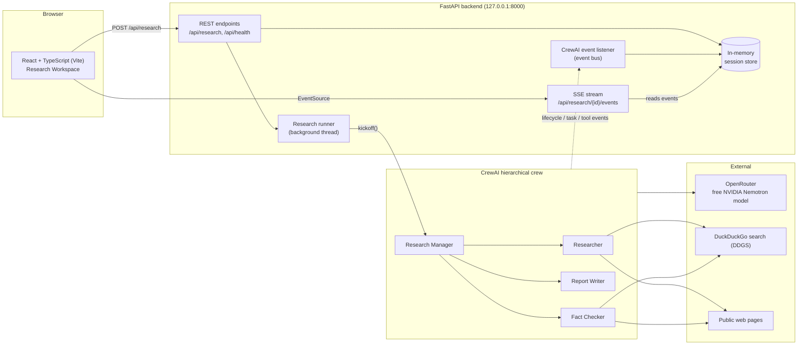
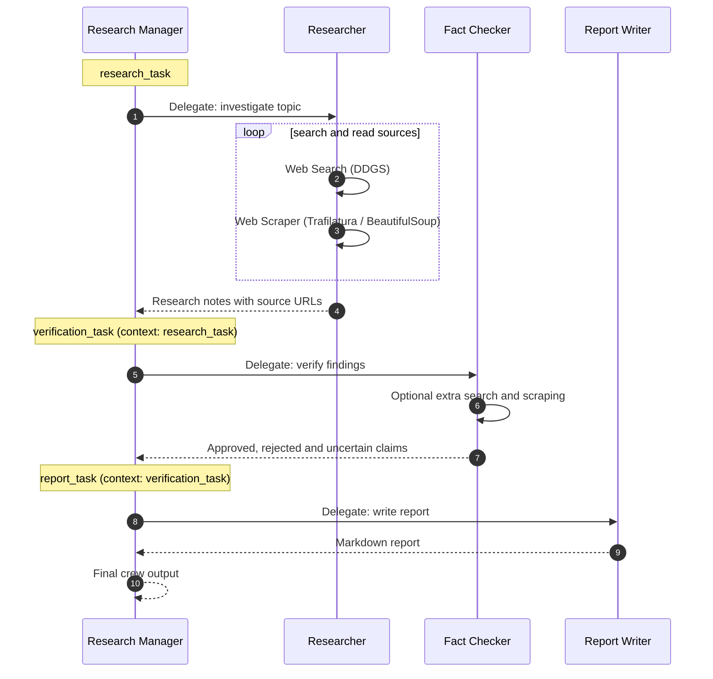

# ResearchCrew AI

A hierarchical multi-agent research system built with CrewAI. A manager agent plans the work and delegates it to three specialists: a researcher, a fact checker and a report writer. Together they produce a cited Markdown research report. A FastAPI backend runs the crew and streams its real execution events to a React workspace over Server-Sent Events.

> Status: local development MVP. It is not a production service. See [Current limitations](#current-limitations).

## Problem

Asking a single LLM prompt for a research summary tends to produce unsourced claims. ResearchCrew AI splits the work the way a small research team would:

- gather evidence from live web sources,
- check that evidence independently,
- write only from the verified findings.

You can watch each step as it happens instead of waiting on a black box.

## Features

| Feature | State |
| --- | --- |
| Hierarchical CrewAI crew with four agents (manager plus three specialists) | Implemented |
| Custom web search tool (DDGS) and web scraper (HTTPX + Trafilatura, BeautifulSoup fallback) | Implemented, used successfully in runs |
| CLI entry point (`crewai run`) | Implemented, unchanged |
| FastAPI layer: start research, read status, stream events, health check | Implemented, smoke-tested |
| Live agent status and activity log built from CrewAI event-bus events | Implemented, verified against a real run |
| Markdown report rendering (GFM tables, code, links), copy and download | Implemented |
| Error handling: daily free-model quota (with reset time) vs. temporary rate limits, auth errors, timeouts, crew failures, lost sessions | Implemented; auth and daily-quota paths verified |
| Full end-to-end quality evaluation of reports | Not done |

## Architecture



## Agents

| Agent | Role in `agents.yaml` | Tools | Responsibility |
| --- | --- | --- | --- |
| Research Manager | Research Director | Delegation tools (from CrewAI) | Plans the research, delegates each task, reviews results and asks for more work when evidence is weak |
| Researcher | Senior Research Analyst | Web Search, Web Scraper | Runs searches, selects credible sources, extracts page content and records findings with exact URLs |
| Fact Checker | Evidence Verification Specialist | Web Search, Web Scraper | Classifies claims as supported, contradicted or unverified and removes unsupported statistics and citations |
| Report Writer | Research Report Writer | None | Turns the verified findings into a structured Markdown report with references |

Agent and task definitions are in [`backend/src/backend/config`](backend/src/backend/config). The crew is assembled in [`crew.py`](backend/src/backend/crew.py).

## Hierarchical workflow



The manager can delegate more than once per task, or ask a coworker a question, when a result is not good enough. The UI does not assume a fixed order. It shows whatever the event bus reports.

## Design decisions

**Hierarchical orchestration.** `Process.hierarchical` with a custom `manager_agent` keeps planning and quality control in one place. Specialists set `allow_delegation=False`, so only the manager routes work. That prevents delegation loops between specialists.

**Manager delegation.** In hierarchical mode, CrewAI gives the manager "Delegate work to coworker" and "Ask question to coworker" tools. Each task description tells the manager which specialist to use. The manager stays free to re-delegate if the result is incomplete.

**Agent specialization.** Each agent has a narrow goal and only the tools it needs. The Report Writer has no web tools, so it can only write from the verified material it receives. Each agent also has its own `max_iter` budget.

**Task context sharing.** `verification_task` receives `research_task` as context, and `report_task` receives `verification_task`. Evidence moves forward explicitly instead of relying on shared memory.

**Custom search and scraping tools.** Two `@tool` functions wrap small service modules (`services/search_service.py`, `services/scrape_service.py`). Both return compact JSON (title, URL, snippet / content, extraction method, truncation flag). Errors come back as JSON so a failed source does not crash the agent. Page content is capped at 4,000 characters per call to stay inside the context window.

**Trafilatura with BeautifulSoup fallback.** Trafilatura extracts the main article text well on most pages. When it returns too little text (under 200 characters), the scraper strips scripts, navigation and footers with BeautifulSoup and reads `<article>`, `<main>` or `<body>` instead.

**FastAPI integration.** The API is a thin layer: it calls the same `ResearchCrew().crew().kickoff()` that the CLI uses. The research logic has a single implementation. The crew blocks while it runs, so it runs in a background thread and never on the async event loop.

**Server-Sent Events.** Updates only flow from server to client, so SSE is simpler than WebSockets. The browser's `EventSource` reconnects on its own, and the server replays from `Last-Event-ID`. Every session keeps its full event list, so a client that connects late or refreshes the page sees everything from the start.

**Real execution tracking.** A `BaseEventListener` subscribes once per process to CrewAI's event bus: crew kickoff, task start/complete/fail, agent execution start/complete/error, tool usage start/finish/error and LLM call failures. Events are routed to the right session through a `ContextVar` set in the worker thread. CrewAI copies that context into its handler threads. Handlers run in a thread pool, so each event carries CrewAI's `emission_sequence`. Agent state ignores stale updates, and the UI sorts the log by that sequence. Only short summaries are streamed (search queries, source domains, page titles, outcomes). Prompts, raw page content and model reasoning are never sent. Strings shaped like API keys are redacted from error details.

**Free OpenRouter model.** The crew uses a free NVIDIA Nemotron model through OpenRouter (`MODEL` in `.env`), so anyone can run the project without paid credits. The cost is rate limits and variable latency, documented below. The app never switches to a paid model automatically.

## Tech stack

- Backend: Python 3.12, CrewAI 1.15, FastAPI, Uvicorn, DDGS, HTTPX, BeautifulSoup, Trafilatura, uv
- LLM: OpenRouter, free NVIDIA Nemotron model
- Frontend: React 19, TypeScript, Vite, react-markdown with remark-gfm, lucide-react, plain CSS

## Project structure

```
ResearchCrew-AI/
├── backend/
│   ├── src/backend/
│   │   ├── api/
│   │   │   └── app.py              # FastAPI app, REST + SSE endpoints, `serve` entry point
│   │   ├── config/
│   │   │   ├── agents.yaml         # agent roles, goals, backstories
│   │   │   └── tasks.yaml          # research, verification and report tasks
│   │   ├── services/
│   │   │   ├── errors.py           # error classification (quota, rate limit, ...), redaction
│   │   │   ├── event_tracker.py    # CrewAI event-bus listener -> normalized events
│   │   │   ├── research_runner.py  # runs the crew in a background thread, error mapping
│   │   │   ├── session_store.py    # in-memory sessions, agent states, event log
│   │   │   ├── search_service.py   # DDGS search
│   │   │   └── scrape_service.py   # HTTPX fetch + Trafilatura / BeautifulSoup extraction
│   │   ├── tools/
│   │   │   ├── web_search.py       # "Web Search" CrewAI tool
│   │   │   └── web_scraper.py      # "Web Scraper" CrewAI tool
│   │   ├── crew.py                 # hierarchical crew definition
│   │   └── main.py                 # CLI entry point (crewai run)
│   ├── .env.example
│   ├── pyproject.toml
│   └── uv.lock
├── frontend/
│   ├── src/
│   │   ├── components/             # Header, ResearchForm, AgentPanel, ActivityLog, ReportView
│   │   ├── services/api.ts         # REST client and SSE subscription
│   │   ├── types/research.ts
│   │   ├── App.tsx
│   │   └── styles.css
│   ├── index.html
│   ├── package.json
│   ├── package-lock.json
│   └── vite.config.ts              # dev server with /api proxy to the backend
└── README.md
```

## Getting started

### Prerequisites

- Python 3.10–3.13 (the project pins 3.12 in `.python-version`)
- [uv](https://docs.astral.sh/uv/)
- Node.js 20 or newer, with npm
- An [OpenRouter](https://openrouter.ai/) API key (a free account is enough)
- Optional: the CrewAI CLI (`uv tool install crewai`) to use `crewai run`

### Install

```bash
git clone https://github.com/Sleepyamg/ResearchCrew-AI.git
cd ResearchCrew-AI

cd backend
uv sync

cd ../frontend
npm install
```

### Configure environment variables

```bash
cd backend
cp .env.example .env
```

| Variable | Required | Description |
| --- | --- | --- |
| `OPENROUTER_API_KEY` | Yes | OpenRouter API key |
| `MODEL` | Yes | Model id, e.g. `openrouter/nvidia/nemotron-3-ultra-550b-a55b:free` |
| `API_HOST` / `API_PORT` | No | API bind address, defaults to `127.0.0.1:8000` |
| `CORS_ORIGINS` | No | Comma-separated allowed origins, defaults to the Vite dev server |
| `CREWAI_TRACING_ENABLED` | No | The API server defaults this to `false`, so CrewAI never waits on its interactive trace prompt in a background thread |

`.env` is git-ignored. The key is only read by the backend and never sent to the frontend.

### Run the backend

```bash
cd backend
uv run serve
```

This starts the API at `http://127.0.0.1:8000`. Interactive API docs are at `http://127.0.0.1:8000/docs`.

### Run the frontend

```bash
cd frontend
npm run dev
```

Open **http://127.0.0.1:5173**. The Vite dev server proxies `/api` to the backend, so the browser only talks to one origin.

For a production build: `npm run build` (output in `frontend/dist/`).

### CLI usage

The original command-line flow still works:

```bash
cd backend
crewai run        # or: uv run run_crew
```

It prompts for a topic, runs the same crew and prints the result. The final report is also written to `backend/output/research_report.md`, which is git-ignored.

## API

| Method | Path | Description |
| --- | --- | --- |
| `GET` | `/api/health` | Backend status, whether `MODEL` and the API key are configured, and the active session id |
| `POST` | `/api/research` | Body `{"topic": "..."}` (1–2000 chars). Starts a session and returns `202` with the session. Returns `409` if one is already running, `422` for an empty topic |
| `GET` | `/api/research/{id}` | Session snapshot: status, agent states, events, report, error, timestamps |
| `GET` | `/api/research/{id}/events` | SSE stream. Sends `activity` events (replayed from the start or from `Last-Event-ID`), then one `done` event with the final snapshot |

Example `activity` event:

```json
{
  "id": 14,
  "seq": 41.0,
  "type": "tool_started",
  "agent": "researcher",
  "tool": "Web Search",
  "message": "Searching: \"CrewAI hierarchical process documentation\"",
  "detail": null,
  "level": "info",
  "timestamp": "2026-11-26T07:32:10.512Z"
}
```

Event types: `session_started`, `crew_started`, `task_started`, `task_completed`, `task_failed`, `agent_status`, `delegation`, `tool_started`, `tool_finished`, `tool_error`, `llm_error`, `crew_completed`, `crew_failed`, `session_completed`, `session_failed`.

Session status values are `queued`, `running`, `completed` and `failed`. Agent status values are `pending`, `working`, `coordinating`, `completed` and `failed`.

## Example research question

```
Compare LangChain Deep Agents and CrewAI.
```

A run takes several minutes with the free model. You will see the manager delegate to the Researcher, the Researcher's search queries and the domains it reads, then the verification and writing phases.

## Screenshots

Screenshots can be added to `docs/screenshots/` and linked here.

## Current limitations

- **Free-model rate limits.** OpenRouter free models have a per-minute rate limit and a daily request quota (50 requests per day without credits at the time of writing), and a single research run uses a large share of the daily quota. The UI tells the two apart and shows the quota reset time when OpenRouter provides it. Raw provider errors are kept in a collapsible Details section.
- **Approximate context handling.** The 32k context window is configured by hand, and CrewAI's token counting is approximate, so long runs can still overflow or trigger summarization.
- **Inconsistent search results.** DDGS results vary between runs and regions. Report quality depends on which sources come back.
- **Website access restrictions.** Some sites block bots, need JavaScript or return non-HTML content. The scraper returns an error and the agent has to pick another source.
- **Extraction truncation.** Page content is cut at 4,000 characters per call, so details further down a long page are missed.
- **LLM citation and verification errors.** The fact checker is itself an LLM. Reports can still contain misattributed or unsupported claims, so check important references by hand.
- **No full end-to-end evaluation.** The research and scraping steps have run successfully, and the web workflow was exercised against a live run. Report quality has not been systematically evaluated.
- **In-memory sessions.** Sessions are lost when the backend restarts, and only one research run executes at a time.
- **No production-grade SSRF protection.** The scraper accepts any `http(s)` URL the agent chooses, including private network addresses. Run it only on a trusted machine. The API does not expose the scraper directly.
- **Prompt injection.** Retrieved web pages go into agent prompts, so a malicious page can try to steer the agents.
- **No authentication.** The API binds to localhost and is meant for local use only.

## Future improvements

- Persistent sessions and research history (SQLite or Postgres)
- Report-quality evaluation (CrewAI evals or a custom rubric with citation checks)
- SSRF protection for the scraper: block private IP ranges, resolve DNS before fetching, limit response sizes
- Prompt-injection mitigations for retrieved content
- Structured outputs (Pydantic) for research notes and verification results
- Cancelling a running session from the UI
- Retry with backoff for rate-limited LLM calls
- Automated tests for the tools, the event normalization and the API
